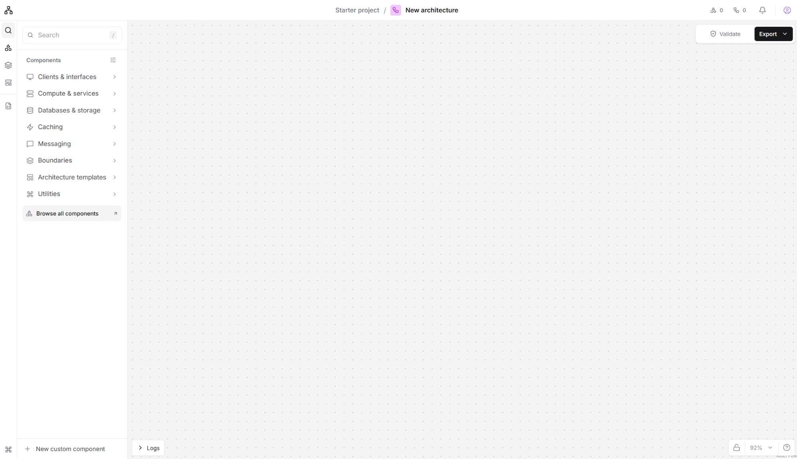

# SwiftBuild

An open-source Architecture IDE and System Design Workbench. Design systems with components and connections that carry engineering meaning.



## Start locally

Requires Node.js 24 and pnpm 10.28.1.

```sh
pnpm install
pnpm dev
```

Open http://localhost:3000. The workbench restores your browser draft or starts with an empty architecture. Search the component catalog to begin, or choose the commerce example from Architecture templates. Configure components, connect semantic ports, and export a portable JSON document.

## Bootstrap capabilities

- Versioned architecture schema with stable IDs and separate layout data
- Six generic components and validated configuration
- Canvas navigation, grouping, selection, duplication, deletion, and undo/redo
- Browser-local draft with validated JSON import/export
- Accessible object list, keyboard shortcuts, and light/dark themes
- Persistent searchable catalog, portable custom components based on validated primitives, canvas locking, and activity logs

Drafts stay in this browser and origin. Export JSON for durable backups or transfer. This bootstrap does not provide accounts, server projects, engineering rule evaluation, capacity calculation, YAML, or collaboration.

## Development and contribution

Read [DEVELOPMENT.md](DEVELOPMENT.md), [CONTRIBUTING.md](CONTRIBUTING.md), and [AGENT.md](AGENT.md). Architecture documentation lives in [docs/architecture](docs/architecture). Run `pnpm verify` before proposing changes and `pnpm test:e2e` for editor changes.

## Self-host

```sh
docker compose up --build
```

See [self-hosting](docs/self-hosting/README.md). No managed service is required.

## Security and license

See [SECURITY.md](SECURITY.md). Licensed under Apache-2.0. Bundled font and icon notices are listed in [NOTICE](NOTICE).
