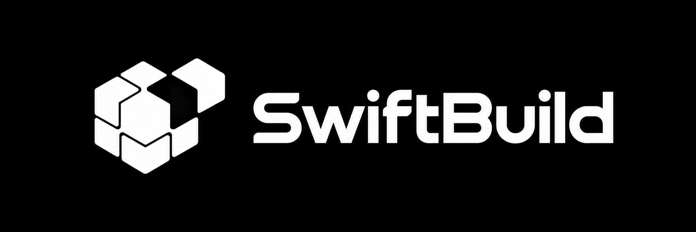
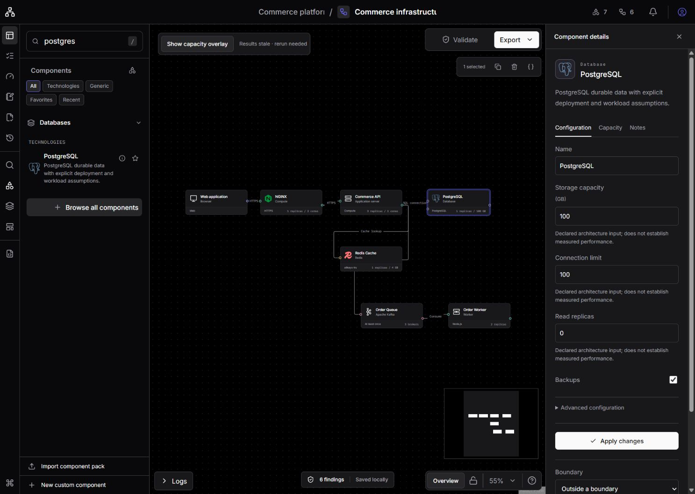
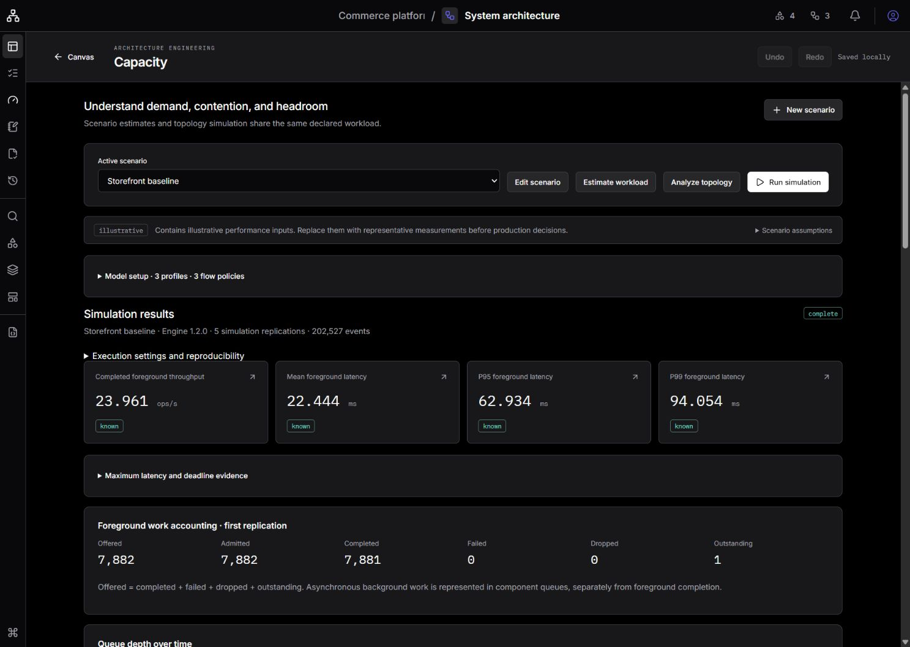
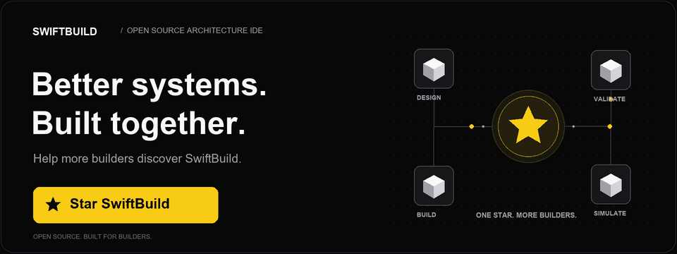

<p align="center">
  
</p>

# SwiftBuild

An open-source Architecture IDE and System Design Workbench. Design systems with components and connections that carry engineering meaning.

[Quickstart](#start-locally) · [Documentation](docs/README.md) · [Roadmap](docs/roadmap.md) · [Contribute](CONTRIBUTING.md)



[View the light theme](docs/assets/workbench-light.png). Both workbench captures use a 1487 by 1058 viewport. These are existing product illustrations, not fresh verification captures.

## Start locally

Requires runtime major version 24 (`node`) and package manager version 10.28.1 (`pnpm`). These versions follow the repository manifests.

```sh
pnpm install
pnpm dev
```

Open http://localhost:3000. The workbench restores your browser workspace or starts with an empty architecture. Search the component catalog, choose the commerce template, or use the engineering example to explore scenarios and simulation. Example measurements are explicitly illustrative.

## Workbench capabilities

- Versioned architecture schema with stable IDs and separate layout data
- Generic clients, services, workers, load balancers, databases, caches, queues and boundaries
- Direct infrastructure technology selection, contextual configuration and local SVG identity across 35 technologies/provider services
- Searchable taxonomy, technology/generic filters, favorites, recents, details, drag/keyboard insertion and validated local component packs
- Canvas navigation, grouping, selection, duplication, deletion, and undo/redo
- Transactional browser workspace, validated native JSON and project archives, and recoverable named checkpoints
- Accessible object list, keyboard shortcuts, and light/dark themes
- Default neutral black/zinc dark surfaces, retained light theme and preference restoration before hydration
- Persistent searchable catalog, portable custom components based on validated primitives, canvas locking, and activity logs
- Linked requirements, decision records, evidence-based assessments and deterministic engineering findings
- Workload scenarios, growth and bursts, analytical topology propagation and seeded discrete-event simulation
- Explicit service/CPU/memory behavior, cache routing, queue delivery, retries, timeouts and dependency joins
- Explainable results, saved run comparisons, canvas overlays and semantic/layout checkpoint comparisons

The default workbench saves work in this browser and origin. Export a project archive to preserve checkpoints and engineering evidence. Optional server mode provides invite-only accounts, authorized project lists and editing, transactional saves and immutable revisions. Users can import complete archives or explicitly copy a saved local draft without replacing it. Server conflicts preserve local recovery; viewers edit only local previews. Account screens support password and configured organizational sign-in, with operator-issued invitation/recovery links requiring no mail server. Repeatable full server deployment and tested operational backup/restore remain planned. See [server setup](docs/self-hosting/README.md) and [API contracts](docs/server-api.md).

Missing measurements remain unknown; simulation results describe the supplied model and do not replace production load testing. Read the [engineering guide](docs/engineering/README.md) for supported behavior and limitations. Optional server [engineering analysis](docs/engineering/analysis.md) adds isolated Python reliability and numerical sensitivity jobs while retaining the TypeScript engines. Collaboration, YAML/CLI architecture tooling and deployment integration remain in the [full product roadmap](docs/roadmap.md). The open-source product uses manual architecture design without AI adoption.



## Development and contribution

Server APIs, identity, persistence, jobs and operators run in the [Python FastAPI backend](services/backend/README.md). Next.js renders the application and forwards same-origin HTTP. Browser-local mode needs no backend. The legacy TypeScript server package remains temporarily for compatibility references; Docker deployment changes are deferred.

The [current status](docs/status.md) records implemented capabilities, limitations and dated verification. Read [DEVELOPMENT.md](DEVELOPMENT.md), [CONTRIBUTING.md](CONTRIBUTING.md), and [AGENT.md](AGENT.md). Browse the [documentation hub](docs/README.md) for architecture, engineering, recovery and planned work. Run `pnpm verify` before proposing changes and `pnpm test:e2e` for editor changes.

## Self-host

```sh
docker compose up --build
```

See [self-hosting](docs/self-hosting/README.md). No managed service is required.

## Star SwiftBuild

If SwiftBuild helps you design better systems, give the repository a star. Help more builders discover it and shape what comes next.

<p align="center">
  <a href="https://github.com/SwiftBuild-ai/SwiftBuild">
    <picture>
      <source media="(prefers-reduced-motion: reduce)" srcset="docs/assets/star-swiftbuild.png" />
      
    </picture>
  </a>
</p>

[View the still banner](docs/assets/star-swiftbuild.png).

## Security and license

See [SECURITY.md](SECURITY.md). Licensed under Apache-2.0. Bundled font and icon notices are listed in [NOTICE](NOTICE).
